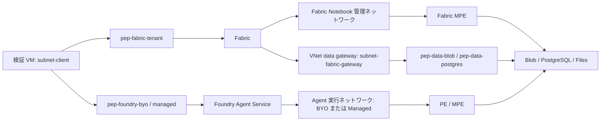

# 0. 最初に理解する構成

[目次](../README.md) | [次: 準備](./01-prerequisites-network.md)

## 0-1. 「閉域」は何を閉じるのか

Azure の PaaS は、初期状態では一般に Public FQDN を持ちます。ネットワークの許可と認証の許可は独立しています。

| 用語 | 初心者向けの意味 |
|---|---|
| VNet | Azure 内で自分が管理するネットワーク |
| Subnet | VNet の中で用途を分ける区画 |
| Private Endpoint (PE) | 自分の Subnet に Private IP の入口を作り、PaaS に接続する仕組み |
| Managed Private Endpoint (MPE) | サービス管理ネットワーク側にサービスが作る PE。自分の VM 用 PE とは別 |
| Private DNS zone | 普段の接続先 FQDN を Private IP に解決するための名前解決設定 |
| Public Network Access Disabled | 公開側のデータプレーン入口をサービスが拒否する設定 |
| Managed Identity / Entra identity | コードに Storage Access Key を入れずに認証するための ID |
| RBAC | その ID が「何をしてよいか」を決める権限 |
| Delegation | 特定サービス専用として Subnet を割り当てること |

**PE を作っただけでは公開入口は閉じません。RBAC を付けただけでは経路は閉域になりません。**

Public FQDN はそのまま使います。例えば `st...blob.core.windows.net` を Private DNS で Private IP に解決します。URL を直接 `https://10.42.x.x/` や `privatelink` の別名に書き換えると、TLS 証明書や Host ヘッダーが合わなくなります。

Service Endpoint はサービスの Public Endpoint への到達制御です。「宛先を Private IP にする」という本検証の PE と同一ではありません。

## 0-2. 入口と出口は別々に構築する



Fabric の入口 PE は Fabric の SaaS 全体をあなたの VNet に移動するものではありません。Foundry の入口 PE も Hosted コンテナの送信経路を作るものではありません。

## 0-3. Foundry で混乱しやすい点

### Prompt Agent

Prompt Agent は、モデル・instructions・tools を宣言して使う Agent です。あなたが Python コードを置ける汎用コンテナではありません。instructions に「PostgreSQL を読みなさい」と書くだけで DB 接続が生まれるわけではありません。

本ガイドでは、Blob／DB を読むコードを **private MCP サーバー**に置きます。

```text
Prompt Agent
  → Agent Service の送信ネットワーク（BYO / Managed）
  → private MCP の PE / MPE（HTTPS）
  → MCP コンテナの VNet（subnet-tools）
  → Blob / PostgreSQL / Files の PE
```

前半は **Foundry の VNet**、後半は **ツールの VNet**です。Managed VNet を選んでも、MCP コンテナから DB への経路は自動で Managed VNet になりません。ツールは自分の実行環境からアクセスします。

Function Calling を選んだ場合は、ツール処理が呼び出し元アプリで実行されることがあります。その場合、実際の DB 接続元はそのアプリです。**VM のコードからデータを読んで Agent に渡す試験を、Agent 自身の送信試験と呼ばない**でください。

### Hosted Agent

Hosted Agent は、あなたのコードを実行するコンテナです。本ガイドではそのコードにデータプローブを追加します。

```text
Hosted Agent コンテナ
  → BYO delegated subnet または Foundry Managed VNet
  → Blob / PostgreSQL / Files の PE / MPE
```

Hosted でも外部 MCP を呼べますが、今回は Prompt と区別するために **コンテナが直接**データを読んで検証します。

## 0-4. BYO VNet と Managed VNet

| 項目 | BYO VNet | Managed VNet |
|---|---|---|
| ネットワーク管理者 | 自分 | Microsoft |
| Agent のネットワーク | 自分の専用 delegated subnet | Microsoft テナント内の管理ネットワーク |
| PE の置き場所 | 自分の `subnet-pe` | 管理ネットワーク側の MPE |
| 入り口の VM 用 PE | 自分で作る | 自分で作る。Managed を選んでも必要 |
| DNS／UDR／NSG | 自分が設計・管理 | 管理部分はサービスが管理 |
| Peering | 自分で可能 | 自分の VNet と自由に Peering する方式ではない |
| オンプレ接続 | VPN／ExpressRoute 等を設計可能 | 任意 IP への直接接続を同等に扱わない。公式対応方式を確認 |
| 方式変更 | 作成時に決定。新規アカウントを使う | 有効化後に無効化不可。BYO から直接移行不可 |
| Prompt と Hosted | 両方に適用 | 両方に適用 |

Foundry の Managed VNet と Fabric の管理ネットワークは **別のネットワーク**です。「Managed VNet」という同じ言葉でも MPE を共有しません。

## 0-5. Basic / Standard とネットワーク方式は別の軸

- **Basic**: Agent の状態データ等をプラットフォーム管理リソースで扱う。
- **Standard**: Agent の状態データ等に、自分の Storage／Cosmos DB／AI Search を持ち込む。
- **BYO VNet / Managed VNet**: Agent の送信ネットワークの管理方式。

「BYO VNet を選ぶには必ず Cosmos DB と Search を作る」は誤りです。本ガイドの BYO は Basic を使い、業務データとして別の Blob／PostgreSQL を読みます。Managed もまず Basic 相当の最小作成フローを使います。

これは「状態データも含めて全て自社管理リソース」という監査要件を満たすことを証明しません。その要件がある場合は [公式 Standard テンプレート](https://github.com/microsoft-foundry/foundry-samples/tree/main/infrastructure/infrastructure-setup-bicep/15-private-network-standard-agent-setup)／[Managed テンプレート](https://github.com/microsoft-foundry/foundry-samples/tree/main/infrastructure/infrastructure-setup-bicep/18-managed-virtual-network)へ進みます。業務データと Agent 内部データの Storage を混同しないでください。

## 0-6. 認証は通信経路とは別

| 接続 | 本ガイドの認証 |
|---|---|
| VM → Fabric / Foundry | 検証ユーザーの Entra ID |
| Fabric Dataflow → Blob | Organizational account |
| Fabric Dataflow → PostgreSQL | 読み取り専用 DB ユーザーの Basic 認証 |
| Fabric Notebook → Blob / Files | 実行ユーザーの Storage OAuth token |
| Prompt → MCP | 検証用 MCP 専用トークンを project connection に保存 |
| MCP → Blob / Files / PostgreSQL | ツールに付けた User Assigned Managed Identity |
| Hosted → Blob / Files / PostgreSQL | プラットフォーム作成の Agent identity |

MCP 専用トークンは **Storage Access Key ではありません**。初心者向けラボでは、データ取得 ID と MCP 接続認証を分離するため、この方式を使います。組織が全サービスのキーを禁止している場合は実施を止め、MCP 接続も Entra ID 認証に変更してください。Azure Files の SMB を Storage Key でマウントする回避策は使いません。

根拠: [Foundry networking options](https://learn.microsoft.com/azure/foundry/agents/concepts/networking-options)、[Foundry private link / tool traffic](https://learn.microsoft.com/azure/foundry/how-to/configure-private-link)、[Fabric MPE](https://learn.microsoft.com/fabric/security/security-managed-private-endpoints-overview)。
